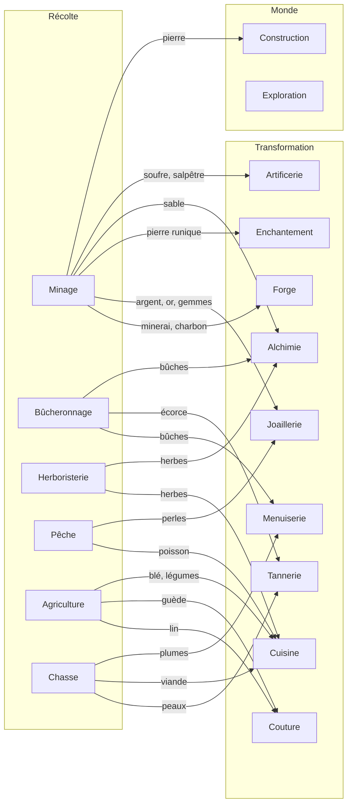
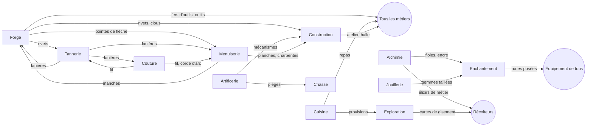

# Écosystème des métiers

> **Statut : recommandation**, à arbitrer par Louis (voir [`arbitrages.md`](arbitrages.md)). Les 6 métiers de la boucle (Minage, Bûcheronnage, Herboristerie, Forge, Menuiserie, Cuisine) sont jouables depuis le 21 octobre.
> Les chiffres viennent du simulateur (`sim/`, proposition `sim/proposals/boucle-v0/`) et se régénèrent avec `pnpm --filter @bramo/sim sim report`.
> Légende utilisée dans tous les documents de conception : **[Décidé]** = choix de Louis · **[Recommandé]** = proposition argumentée · **[Ouvert]** = question sans réponse.

## 1. Ce qui ne fonctionne pas dans la liste actuelle

- **Des matières sans transformation, des transformations sans matière.** La Chasse « rapporte cuirs et viandes » mais rien ne tanne une peau ; la Couture fait « tissus, cuirs et tenues » sans qu'aucun métier ne produise de fibre ; l'Enchantement et l'Artificerie n'ont aucune entrée définie ; les gemmes n'existent pas.
- **Couture trop large.** Tissu et cuir sont deux filières complètes (fibre → fil → toile ; peau → tannage → cuir) qui habillent deux styles de combat différents. Les réunir donne un métier énorme et un Traqueur dont l'armure dépend du même artisan que le Runiste.
- **Des outils pour un seul métier.** Seul le Minage a un outil. Les autres récolteurs n'ont aucune raison d'acheter quoi que ce soit.
- **Construction et Exploration sans fonction.** Construction « bâtit les projets du clan » sans dire ce qu'elle consomme ni ce qu'elle produit ; Exploration « découvre des lieux » sans débouché.
- **Les repas sont absurdement rentables.** Le Festin du givre se cuit en 10 s pour 1 h de bonus : **360 h de bonus par heure de cuisson**, et ×14 de rendement net pour un joueur autonome (rapport du simulateur, « Repas actuels »). Une heure de cuisine nourrit un serveur entier pendant des jours : la Cuisine n'a pas de demande.
- **Le poisson vient de la Pêche** (jouable depuis le 21 octobre) ; le marchand PNJ n'existe plus.

## 2. Principes de l'écosystème [Recommandé]

1. **Règle d'utilité** (déjà dans le v1.0) : un métier existe s'il produit ce dont d'autres ont besoin, ou s'il ouvre un système.
2. **Règle de décision** : un métier autonome offre au moins deux décisions qui lui sont propres (quoi cultiver et quand, quelle qualité viser, quelle rune pour quel objet…). Une simple conversion 1 → 1 sans choix est une **catégorie de recettes** d'un métier voisin, pas un métier (fonte, tannage seul, teinture, verrerie, maçonnerie).
3. **Trois armures pour trois styles** : métal (Forge) pour la mêlée, cuir (Tannerie) pour le tir, tissu (Couture) pour la magie. Les bijoux (Joaillerie) et les runes (Enchantement) servent tout le monde.
4. **Profondeur limitée** : au plus trois transformations entre la matière brute et l'objet utilisé aux paliers courants, quatre en fin de jeu. Au-delà, l'autonomie devient une corvée de file d'actions (voir §6).
5. **Ingrédients transversaux de bas niveau** : rivets, manches, fil, lanières, fioles, écorce. Ils relient les métiers sans exiger de haut niveau chez le voisin (un débutant les produit, le marché les fournit à bas prix) et donnent aux ressources de bas niveau un débouché pendant toute la partie.
6. **On démarre seul** : chaque métier a un **outil d'apprenti** gratuit, incassable et sans bonus. Les premiers outils fabriqués (bronze) ne demandent que des métiers au niveau 5 au plus (vérifié par un test du simulateur). Aucune recette de début n'exige un produit qu'on ne peut pas faire soi-même en quelques minutes.
7. **Les récolteurs ont aussi des clients à servir et des fournisseurs** : outils (Forge + Menuiserie), repas (Cuisine), élixirs de métier (Alchimie), cartes de gisement (Exploration), appâts (Chasse, Agriculture), pièges (Artificerie), engrais (Agriculture, Alchimie).

## 3. Liste proposée : 17 métiers et 3 extensions

| Métier | Famille | Phase | Rôle en une phrase |
|---|---|---|---|
| Minage | Récolte | Socle A (jouable) | Minerais, charbon, pierre, sable, pierres runiques, gemmes brutes. |
| Bûcheronnage | Récolte | Socle A | Bois d'œuvre et écorce (le tanin des tanneurs). |
| Herboristerie | Récolte | Socle A (jouable) | Herbes sauvages pour la cuisine et l'alchimie, réactifs rares. |
| Pêche | Récolte | Socle B | Poissons, puis coquillages et perles pour la joaillerie. |
| Agriculture | Récolte | Socle B | **Parcelles qui poussent en temps réel** : lin, blé, légumes, plantes tinctoriales. |
| Chasse | Récolte | Socle C (avec le combat) | Peaux, viandes, plumes, trophées. Métier du Traqueur. |
| Forge | Artisanat | Socle A (jouable) | Fonte des métaux communs, **outils de tous les métiers**, armes et armures de métal. Métier du Forgefeu. |
| Menuiserie | Artisanat | Socle A | Planches, **manches de tous les outils**, arcs, flèches, bâtons, bois de charpente. |
| Cuisine | Artisanat | Socle A (jouable) | Repas longs qui accélèrent le travail, vivres de combat, provisions d'expédition. |
| Alchimie | Artisanat | Socle B | Fioles, potions de combat, élixirs de métier, réactifs (encre runique). Métier de l'Alchimiste. |
| Tannerie | Artisanat | Socle C | Tanner les peaux, travailler le cuir : armures de tir, lanières, sacs. **Nouveau, séparé de la Couture.** |
| Couture | Artisanat | Socle C | Filer, tisser, teindre, coudre : armures de magie, voiles, bannières. |
| Joaillerie | Artisanat | Socle C | Affiner l'argent et l'or, tailler les gemmes, sertir anneaux et amulettes. **Nouveau.** |
| Enchantement | Artisanat | Socle C | Graver des runes et les poser sur n'importe quel équipement. Métier du Runiste. |
| Artificerie | Artisanat | Phase D | Mécanismes, pièges, poudres, bombes, engins de chantier. Métier de l'Artificier. |
| Construction | Monde | Socle B (avec les clans) | **Le grand puits** : poser des éléments dans l'atelier personnel et la halle du clan. |
| Exploration | Monde | Phase D | Expéditions qui rapportent des **cartes de gisement**, des curiosités et des sites. |
| *Élevage* | *Récolte* | *Extension* | *Laine, lait, œufs, plumes. D'abord une branche de l'Agriculture (enclos à côté des parcelles), métier autonome si le contenu le justifie.* |
| *Archéologie* | *Monde* | *Extension* | *Fouiller les sites trouvés par l'Exploration : reliques de collection, matériaux anciens, plans de recettes.* |
| *Dressage* | *Monde* | *Extension* | *Compagnons (Meneur de meute du Traqueur) et montures d'expédition. Dépend de l'Élevage.* |

Phases : **A** = la boucle de test, maintenant ; **B** = avec le marché et les clans (P2–P3) ; **C** = avec le combat (P4), car ces métiers produisent surtout de l'équipement de combat ; **D** = avec les classes de métier (P5).

**Écartés comme métiers, gardés comme catégories** : Fonderie (Forge), tannage seul (Tannerie), Teinturerie (Couture), Verrerie (Alchimie : fioles ; Joaillerie : lentilles), Maçonnerie et taille de pierre (Construction), Brasserie (Cuisine), Calligraphie (Enchantement pour les parchemins runiques, Exploration pour les cartes), Apiculture (branche future de l'Agriculture : miel, cire), Commerce (le marché est déjà le métier du marchand ; une compétence « Négoce » créerait de l'or de nulle part), Navigation (à reconsidérer avec l'Exploration, bien plus tard).

**Pourquoi 17 et pas 30** : avec 20 joueurs, 17 métiers donnent en moyenne 0,7 spécialiste par métier et neuf métiers sans aucun spécialiste (rapport du simulateur, « Taille du serveur »). Chaque métier ajouté dilue le marché. Il vaut mieux ouvrir les métiers par phases, au rythme de la population, que lancer 30 métiers vides.

## 4. Carte des dépendances

Matières premières vers transformations (les flèches portent le produit principal) :

Produits transversaux et usages (qui sert qui) :

Il n'y a **aucune boucle au démarrage** : la seule dépendance circulaire possible (Forge ↔ Menuiserie pour les outils, Forge ↔ Tannerie pour rivets et lanières) ne bloque jamais, car les outils d'apprenti existent et les ingrédients croisés sont de niveau 1. Le simulateur vérifie qu'aucune chaîne ne boucle.

## 5. Fiches des métiers

Pour chaque métier : identité et décisions · matières et provenance · productions · qui les consomme · débouchés récurrents · place en début, milieu et fin · pourquoi il est autonome · phase.

### Minage *(Socle A, jouable)*
- **Identité** : lire la roche. Décisions : quel filon (XP, valeur, demande du marché), métal commun ou précieux, gemmes (lentes, rares, chères) ou volume.
- **Matières** : aucune ; outil (pioche) de la Forge, élixir du mineur (Alchimie), carte de gisement (Exploration), repas.
- **Productions** : cuivre, étain, fer, charbon, argent, mithril, or, orichalque, azurite, sombracier, astralite ; pierre, sable, pierre runique ; améthyste brute et autres gemmes.
- **Consommateurs** : Forge (métaux communs), Joaillerie (argent, or, gemmes), Enchantement (pierre runique), Alchimie (sable des fioles), Construction (pierre), Artificerie (soufre, salpêtre).
- **Débouchés récurrents** : la Forge monte de niveau en consommant du minerai ; les fioles et la pierre de construction consomment du bas niveau toute la partie.
- **Progression** : début = cuivre et étain pour son premier outil ; milieu = fer, charbon, argent, gemmes ; fin = minerais rares en petite quantité, très demandés par les forgerons de haut niveau.
- **Autonome** : premier fournisseur de cinq métiers.

### Bûcheronnage *(Socle A)*
- **Identité** : essences de bois. Décisions : bois d'œuvre (Menuiserie) ou écorce (Tannerie), essence rare pour arcs et bâtons.
- **Matières** : aucune ; hache (Forge + Menuiserie).
- **Productions** : pin, chêne, frêne, if, bois de lune… et **écorce à chaque coupe de pin et de chêne**.
- **Consommateurs** : Menuiserie (planches, manches, arcs), Tannerie (écorce), Alchimie (bois de chauffe des fioles), Construction (via Menuiserie).
- **Débouchés récurrents** : manches de tous les outils, flèches, charpentes des projets.
- **Progression** : le pin sert jusqu'en fin de jeu (hampes de flèche, fioles) ; les essences rares deviennent des arcs et des bâtons.
- **Autonome** : seule source de bois et de tanin.

### Herboristerie *(Socle A, jouable)*
- **Identité** : cueillette sauvage. Décisions : herbe de cuisine ou réactif d'alchimie, quantité ou rareté.
- **Matières** : aucune ; serpe (Forge + Menuiserie).
- **Productions** : menthe, thym, ortie, sauge, lys-lanterne, fleur de givre, puis champignons et réactifs rares.
- **Consommateurs** : Cuisine (aromates), Alchimie (potions, élixirs, encre).
- **Débouchés récurrents** : chaque repas et chaque potion.
- **Distinct de l'Agriculture** : l'herboriste cueille du sauvage, varié et rare, en occupant son activité ; l'agriculteur cultive peu d'espèces en volume, en parallèle.

### Pêche *(Socle B)*
- **Identité** : eaux et appâts. Décisions : quelle eau, quel appât (vers de l'Agriculture, viande de la Chasse) pour quelle prise.
- **Matières** : canne (Menuiserie + fil de Couture), appâts.
- **Productions** : poissons, coquillages, perles (rares).
- **Consommateurs** : Cuisine (protéine principale des repas), Joaillerie (perles), Agriculture (déchets → engrais).
- **Débouchés récurrents** : la moitié des repas.
- **Remplace** le marchand du port du prototype.

### Agriculture *(Socle B)*
- **Identité** : **gérer des parcelles qui poussent en temps réel**, en parallèle de l'activité. Semer et récolter sont des gestes instantanés ; la culture pousse sans plafond d'absence ; une récolte mûre attend sans se gâter. Décisions : quoi semer (lin, blé, légumes, guède), cultures courtes ou longues, engrais, rotation. Activité propre : préparer les récoltes (teiller le lin, battre le blé, faire la pâte de guède, composter).
- **Matières** : graines (gardées des récoltes, vendues par le PNJ au début), engrais (compost de déchets de bas niveau, puis Alchimie).
- **Productions** : filasse de lin, grain, carottes et légumes, teinture de guède, puis coton et plantes rares.
- **Consommateurs** : Couture (fibres et teintures), Cuisine (pain, légumes), Pêche (appâts), Élevage plus tard (fourrage).
- **Débouchés récurrents** : chaque vêtement de tissu, chaque repas.
- **Place** : 3 parcelles au niveau 1, une de plus tous les 10 à 15 niveaux (10 au 90), plus des champs de clan. Les parcelles sont la contrainte : une tenue de lin demande 49 parcelle·heures, soit 16 h de trois parcelles.
- **Pourquoi c'est une exception à « une seule activité »** : la croissance tourne en parallèle, mais le rendement est borné par le nombre de parcelles, pas par le temps de présence. Elle donne une vraie raison de revenir (récolter, ressemer) sans exiger de rester.
- **[Ouvert]** : la croissance compte-t-elle dans le plafond d'autonomie ? Recommandation : non (rien ne pousse « mieux » quand on est là), mais une parcelle ne se ressème pas toute seule.

### Chasse *(Socle C, avec le combat)*
- **Identité** : pister et piéger. Décisions : quel gibier (peau, viande ou plumes), pièges (Artificerie) ou arc, appâts.
- **Matières** : arc et flèches (Menuiserie), pièges (Artificerie), appâts.
- **Productions** : petites peaux, peaux épaisses, fourrures ; viandes ; plumes ; trophées (os, crocs) pour l'Artificerie et l'Enchantement.
- **Consommateurs** : Tannerie (peaux), Cuisine (viande), Menuiserie (plumes des flèches).
- **Débouchés récurrents** : plumes de toutes les flèches, viande des repas et des compagnons.
- **Métier principal du Traqueur** [Décidé].

### Forge *(Socle A, jouable)*
- **Identité** : le métal commun. Décisions : fondre ou acheter ses lingots, outils ou armes, qualité (chef-d'œuvre) ou volume.
- **Matières** : minerai et charbon (Minage), manches (Menuiserie), lanières (Tannerie).
- **Productions** : lingots (bronze, fer, acier…), **fers d'outils et outils de tous les métiers**, rivets et clous, pointes de flèche, armes et armures de métal.
- **Consommateurs** : tous les métiers (outils), Tannerie et Construction (rivets), Menuiserie (pointes de flèche), combattants de mêlée.
- **Débouchés récurrents** : renouvellement des outils, montée de palier des outils, réparations, rivets des projets de clan.
- **Métier principal du Forgefeu** [Décidé].

### Menuiserie *(Socle A)*
- **Identité** : le bois travaillé. Décisions : manches et planches (volume), archerie (arcs, flèches), bois de charpente pour les projets.
- **Matières** : bûches (Bûcheronnage), plumes (Chasse), pointes (Forge), fil (Couture).
- **Productions** : planches, manches, hampes et flèches, douelles et arcs, bâtons de mage, cannes à pêche, charpentes (pour la Construction).
- **Consommateurs** : Forge (manches de tous les outils), archers (arcs, **flèches consommées**), Runistes (bâtons), Construction.
- **Débouchés récurrents** : les flèches (le seul consommable de combat fabriqué en volume), les manches.

### Cuisine *(Socle A, jouable)*
- **Identité** : le confort de tous. Décisions : quel bonus pour quel client, repas de travail ou vivres de combat, ingrédients chers ou abordables.
- **Matières** : poisson (Pêche), viande (Chasse), herbes (Herboristerie), grain et légumes (Agriculture).
- **Productions** : repas de travail (bonus de vitesse **longs**, un seul actif), vivres de combat (soin, régénération), provisions d'expédition (Exploration).
- **Consommateurs** : tout le monde, en continu (voir le garde-manger, `economie.md`).
- **Distinction avec l'Alchimie** : la Cuisine donne des effets **généraux, modestes et longs** ; l'Alchimie des effets **ciblés, forts et courts** (une potion de soin en combat, un élixir pour un seul métier) et des réactifs pour d'autres artisans.

### Alchimie *(Socle B)*
- **Identité** : effets ciblés et réactifs. Décisions : potion de combat, élixir de métier ou réactif ; puissance ou durée.
- **Matières** : herbes (Herboristerie), sable et charbon (Minage), bois de chauffe (Bûcheronnage), fioles (sa propre verrerie).
- **Productions** : fioles, potions de soin et de combat, élixirs de métier (« Élixir du mineur » : effet propre au Minage, pas de la vitesse générale), encre runique, engrais avancé.
- **Consommateurs** : combattants, récolteurs, Enchantement (encre), Agriculture (engrais).
- **Métier principal de l'Alchimiste** [Décidé].

### Tannerie *(Socle C)* — nouveau, séparé de la Couture
- **Identité** : la peau devient cuir. Décisions : tannage à l'écorce (lent, bon marché) ou aux réactifs (rapide, Alchimie) ; cuir souple ou épais ; armure ou accessoires (lanières, sacs, carquois).
- **Matières** : peaux (Chasse), écorce (Bûcheronnage), fil (Couture), rivets (Forge).
- **Productions** : cuir souple, cuir épais, **lanières** (ingrédient transversal), armures de cuir, carquois, sacs.
- **Consommateurs** : archers (armures), Forge (poignées d'épée), Couture (mitaines), Menuiserie (arcs).
- **Pourquoi le tannage n'est pas un métier à lui seul** : tanner est une conversion peau → cuir sans autre décision que la vitesse. Réuni au travail du cuir, il forme un métier complet qui habille un style de combat.

### Couture *(Socle C)*
- **Identité** : fibre → fil → toile → vêtement. Décisions : teindre ou non (qualité et apparence de la pièce), pièces légères ou robes lourdes, voiles et bannières pour les projets.
- **Matières** : lin et teintures (Agriculture), lanières (Tannerie).
- **Productions** : fil (ingrédient transversal : arcs, armures de cuir), toiles, toiles teintes, robes et tenues de magie, bannières de clan.
- **Consommateurs** : lanceurs de sorts, Tannerie et Menuiserie (fil), clans (bannières).
- **Le fil va du lin au vêtement en 3 transformations** : teiller (Agriculture), filer puis tisser (Couture), coudre (Couture).

### Joaillerie *(Socle C)* — nouveau
- **Identité** : métaux précieux et gemmes. Décisions : quelle gemme pour quel effet, monture simple ou sertie, taille prudente (rendement) ou audacieuse (chance de qualité supérieure).
- **Matières** : argent, or, gemmes brutes (Minage), perles (Pêche).
- **Productions** : lingots d'argent et d'or (affinage), gemmes taillées, anneaux, amulettes, lentilles (Artificerie).
- **Consommateurs** : tout le monde (deux emplacements de bijou proposés : anneau, amulette), Enchantement (gemmes comme foyer des runes fortes), Menuiserie (bâtons sertis).
- **Débouchés récurrents** : montée de palier, recherche de qualité, gemmes consommées par l'Enchantement.
- **Lien Minage → gemmes → taille → Joaillerie** : le mineur trouve les gemmes brutes dans des filons lents (60 s par gemme) ; la taille est une catégorie de la Joaillerie, pas un métier.

### Enchantement *(Socle C)*
- **Identité** : graver et poser des runes. Décisions : quelle rune sur quel objet (le même objet peut recevoir des runes différentes selon le build), runes consommables ou permanentes.
- **Matières** : pierre runique (Minage), encre runique (Alchimie), gemmes taillées (Joaillerie) aux paliers hauts.
- **Productions** : runes (consommables de combat pour le Runiste, ou à poser), **enchantements sur l'équipement fabriqué par d'autres**.
- **Consommateurs** : tous les combattants ; c'est le métier de **commande** par excellence (« runez ma robe »).
- **Métier principal du Runiste** [Décidé].

### Artificerie *(Phase D)*
- **Identité** : mécanismes. Décisions : piège, explosif ou engin ; durabilité ou puissance.
- **Matières** : lingots et rivets (Forge), planches (Menuiserie), soufre et salpêtre (Minage), charbon de bois, lentilles (Joaillerie).
- **Productions** : pièges (Chasse), bombes et fumigènes (Artificier), engins de chantier (Construction : treuils, grues qui réduisent le coût d'un projet), mécanismes d'atelier.
- **Métier principal de l'Artificier** [Décidé].

### Construction *(Socle B, avec les clans)* — transformée
- **Recommandation : la garder, mais comme métier-puits.** Elle fabrique des **éléments** (charpente de chêne, pan de mur, toiture, établi, coffre, serre) à partir de planches, pierre, rivets, toile et mécanismes, puis les **pose** dans l'**atelier personnel** ou la **halle du clan**. Une fois posés, les matériaux sortent du circuit : c'est le plus grand puits de ressources du jeu, et il rapporte de l'XP (comme la Construction de RuneScape).
- **Ce que ça donne** : atelier personnel = postes de travail qui ouvrent des recettes (fumoir, serre = parcelles en plus, coffre = place de stockage), pas de pourcentage de vitesse en plus ; halle du clan = entrepôt, champs du clan, bonus de clan, bannières.
- **Les éléments s'échangent** : un joueur qui ne fait pas de Construction achète une charpente posée par un bâtisseur. Une charpente de chêne coûte 16 min de travail autonome, dont un tiers seulement de Construction.
- **Sans elle**, le simulateur donne 5 % de la production qui sert à quelque chose ; avec 15 % du temps d'artisanat consacré à la Construction, 26 % (voir `economie.md`).

### Exploration *(Phase D)* — fonction précise
- **Recommandation : une activité d'expédition** qui consomme des provisions (Cuisine), des torches et cordes (Menuiserie, Couture) et rapporte :
  1. des **cartes de gisement** : objets échangeables qui ouvrent pour leur porteur un filon riche d'un métier de récolte (+25 % pendant 4 h effectives par exemple, catégorie de bonus « Lieu ») ; elles **remplacent la carte de prospection quotidienne** du v1.0, qui était un bonus de connexion ;
  2. des **curiosités** : matériaux introuvables autrement (réactifs, gemmes rares) ;
  3. des **sites** pour l'Archéologie (extension) et des repaires de combat ;
  4. l'**Atlas** : une collection permanente des lieux visités (titres, cosmétiques).
- **Règle** : une carte rapporte environ deux fois le temps d'expédition qu'elle coûte, comme un repas.

## 6. Chaînes complètes

Temps de travail **autonome** (le joueur fait tout, outils d'apprenti, sans bonus). « Étapes » = recettes différentes à lancer. Une parcelle·heure est le temps d'occupation d'une parcelle d'Agriculture.

| Chaîne | Temps autonome | Part du dernier métier | Étapes | Parcelle·h | Métiers et niveaux requis |
|---|---|---|---|---|---|
| Tenue de lin (capuche, robe, chausses, mitaines) | 2 h 00 | 66 % | 12 | 48,6 | Couture 10, Agriculture 1, Tannerie 1, Chasse 1, Bûcheronnage 1 |
| Robe d'adepte runée | 1 h 54 | 9 % | 17 | 44,7 | Enchantement 25, Couture 25, Minage 20, Alchimie 20, Herboristerie 20, Agriculture 15, Bûcheronnage 1 |
| Pourpoint de cuir | 1 h 05 | 53 % | 11 | 1,2 | Tannerie 25, Chasse 20, Bûcheronnage, Couture, Agriculture, Forge, Minage 1 |
| Épée de fer | 35 min | 57 % | 7 | 0 | Forge 20, Minage 10, Tannerie 1, Chasse 1, Bûcheronnage 1 |
| Arc court de frêne | 26 min | 76 % | 10 | 1,0 | Menuiserie 20, Bûcheronnage 20, Couture, Agriculture, Tannerie, Chasse 1 |
| 150 flèches à pointe de fer | 11 min | 19 % | 8 | 0 | Menuiserie 15, Forge 15, Minage 10, Chasse 5, Bûcheronnage 1 |
| Anneau d'argent à deux améthystes | 24 min | 67 % | 6 | 0 | Joaillerie 40, Minage 35 |
| Pioche de fer | 37 min | 48 % | 7 | 0 | Forge 15, Minage 10, Menuiserie 10, Bûcheronnage 10 |
| Ragoût du traqueur × 12 (24 h de bonus +6 %) | 27 min | 22 % | 4 | 14,4 | Cuisine 25, Chasse 20, Herboristerie 10, Agriculture 5 |
| 10 potions de soin mineures | 13 min | 28 % | 5 | 0 | Alchimie 5, Herboristerie, Minage, Bûcheronnage 1 |
| Charpente de chêne (projet de clan) | 16 min | 32 % | 7 | 0 | Construction 1, Menuiserie 10, Bûcheronnage 10, Forge 1, Minage 1 |

Déroulé des cinq chaînes demandées :

1. **Tenue textile** — Agriculture : semer le lin (49 parcelle·h), teiller 2 tiges → 1 filasse (10 s). Couture : filer 1 filasse → 2 fils (8 s), tisser 20 fils → 1 rouleau de toile (90 s), coudre capuche (4 toiles), robe (10), chausses (6), mitaines (3 toiles + 4 lanières de la Tannerie). Au palier suivant, la toile est teinte à la guède (Agriculture) et la robe reçoit dix runes de garde (Enchantement : pierre runique du Minage + encre de l'Alchimie).
2. **Armure en cuir** — Chasse : cerfs (peau épaisse + venaison en sous-produit). Bûcheronnage : 90 coupes pour 90 écorces (les bûches sont un sous-produit à vendre). Tannerie : peau + 3 écorces → cuir épais (30 s) ; pourpoint = 30 cuirs + 12 fils (Couture) + 40 rivets (Forge). **Le tanin est le vrai coût caché** : 18 min de Bûcheronnage pour 35 min de Tannerie.
3. **Une arme** — Épée : Minage (80 minerais de fer), Forge (fonte, 30 lingots, forge 15 min), poignée en lanières (Tannerie). Arc : Bûcheronnage (frêne), Menuiserie (deux douelles, 5 min chacune ; arc, 10 min), corde en fil de lin (Couture), poignée en lanières.
4. **Un bijou** — Minage : argent (20 minerais) et deux améthystes brutes (filon lent, 60 s chacune). Joaillerie : affinage (10 lingots), anneau (5 min), taille (2 min par gemme), sertissage (5 min).
5. **Un consommable** — Ragoût : Chasse (venaison), Agriculture (carottes), Herboristerie (thym), Cuisine (30 s). Potion : Minage (sable) + Bûcheronnage (bois de chauffe) → fioles (Alchimie), menthe (Herboristerie), brassage (20 s).

## 7. Le coût de l'autonomie avec une seule activité

Trois coûts différents, à ne pas confondre :

1. **Le temps de travail** est modeste aux premiers paliers : 26 min à 2 h pour une pièce d'équipement. En temps effectif, c'est l'équivalent d'une à deux heures sur les 24 h qu'un régulier produit par jour.
2. **Les niveaux requis** sont le vrai coût. La robe runée demande six métiers entre 15 et 25. Un métier passe le niveau 20 en ~10 h effectives et le 25 en ~17 h : **environ quatre jours** de temps de jeu pour tout débloquer. Au palier du niveau 60, le même schéma demanderait quatre métiers à 60, soit **quatre fois 13 jours** pour un spécialiste, plus de **deux mois** : c'est là que le commerce devient la seule voie raisonnable, sans jamais être obligatoire.
3. **La gestion de la file** : une chaîne de 12 à 17 étapes avec une activité et 3 actions en file demande 4 ou 5 visites pour être orchestrée. C'est le coût qui pèse le plus sur un casu.

Le multiplicateur d'autonomie (temps total / temps du dernier métier) va de ×1,3 (arc) à ×11 (robe runée). Règle proposée : **pas plus de ×4 aux paliers courants** pour une pièce d'équipement, ce qui exclut d'ajouter des étapes intermédiaires sans décision (exemple écarté : filer, retordre, puis tisser).

**[Ouvert]** Une commande « fabriquer aussi les ingrédients manquants » qui remplit la file avec les sous-recettes. Elle réduirait le coût n°3 sans toucher aux deux autres. À arbitrer avec la longueur de la file, qui est un confort payant possible.

## 8. Ce qui entretient la demande après l'équipement initial

Résumé (détail et chiffres dans [`economie.md`](economie.md)) :

| Filière | Demande récurrente |
|---|---|
| Outils (Forge, Menuiserie) | Usure à l'usage, montée de palier, outils de chaque nouveau joueur. Faible en volume : ~0,5 % du temps de travail. |
| Repas (Cuisine) | Continue : un repas actif à tout moment chez qui en a les moyens, mangé par le garde-manger. ~2 % du temps de travail du serveur. |
| Flèches, potions, runes de combat | Proportionnelles au temps de combat. |
| Armures, armes, bijoux | Usure en combat, montée de palier, qualité, événements (ensembles thématiques). |
| Bas niveau (rivets, fil, lanières, fioles, écorce, pin) | Ingrédients transversaux consommés par des recettes de haut niveau. |
| Matériaux de construction | Projets personnels et de clan, sans fin (le puits principal). |
| Tout objet fabriqué pour l'XP | Recyclage (40 % des matériaux reviennent), Construction, rachat plancher du PNJ. |
