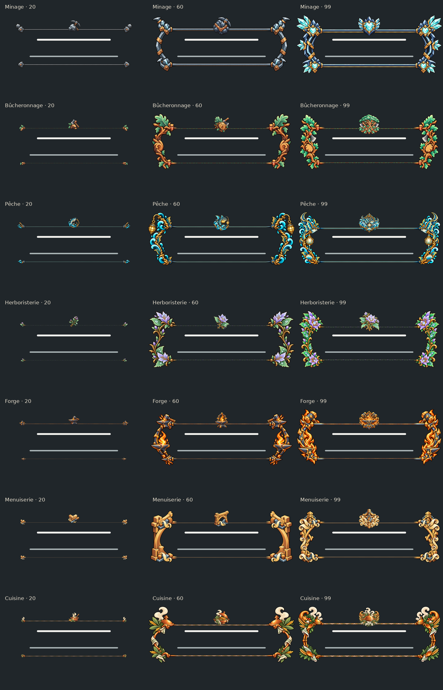

# Ornements Bramo

**Pour Claude : commencer par [README_CLAUDE.md](README_CLAUDE.md).** Les 42 ornements sont aussi disponibles décompressés dans [assets/](assets/), avec leur [manifeste d'intégration](manifest.json), leurs [contrôles](validation.json) et des [utilitaires autonomes](tools/).

Sept métiers, six paliers : **20 / 40 / 60 / 80 / 90 / 99**.

35 titres actuels des épreuves, plus 7 propositions au niveau 90 dont les intitulés restent provisoires.

## Archives

- [Minage](Bramo-minage-famille-v2.zip)
- [Bûcheronnage](Bramo-bucheronnage-famille.zip) · [planche complète](Bramo-bucheronnage-famille.png)
- [Pêche](Bramo-peche-famille.zip) · [planche complète](Bramo-peche-famille.png)
- [Herboristerie](Bramo-herboristerie-famille.zip) · [planche complète](Bramo-herboristerie-famille.png)
- [Forge](Bramo-forge-famille.zip) · [planche complète](Bramo-forge-famille.png)
- [Menuiserie](Bramo-menuiserie-famille.zip) · [planche complète](Bramo-menuiserie-famille.png)
- [Cuisine](Bramo-cuisine-famille.zip) · [planche complète](Bramo-cuisine-famille.png)

## Composition

Bramo — ornements de métier

Chaque dossier de niveau contient six fichiers : gauche, droite, centre, badge,
aperçu et JSON. Les quatre pièces sont des PNG RGBA transparents, déjà à double
résolution : 192×256, 192×256, 128×256 et 128×128 px. Droite = miroir exact.
Le centre se répète horizontalement par périodes de 64 px. Les colonnes de bord
sont identiques. Les motifs restent hors des zones de texte.

Composition : hauteur 256 px ; largeur W≥384 et W−256 multiple de 64.
Afficher les 128 px extérieurs de la gauche, puis répéter le centre de x=128
à W−128, puis les 128 px extérieurs de la droite. Les 64 px de raccord de chaque
extrémité sont une réserve dupliquée : ne pas doubler leur alpha par superposition.
Badge : 96×96, centré en haut, y=0. Nom : y≈108 ; titre : y≈180.
Pour l'interface à résolution normale, diviser toutes ces mesures par deux.
Le jeu écrit les textes : les images ne contiennent que des ornements.

Chaque aperçu réunit les trois largeurs 384, 640 et 960 px sur fond #20262a,
avec des barres factices. Les légendes des planches comparatives sont externes
aux fichiers d'ornement.

Les niveaux 20/40/60/80/99 correspondent aux titres des épreuves actuelles
dans data/trials.yaml. Le 90 est une proposition supplémentaire demandée :
son intitulé reste provisoire et aucune condition de déblocage n'a été modifiée.
Les surnoms de départ restent sans ornement pour préserver la récompense au 20.
Ces archives livrent les assets ; elles n'activent pas encore leur rendu en jeu.

Création des dessins avec le générateur d’images intégré, puis recadrage et réduction en alpha prémultiplié, miroir exact et raccords par code.
